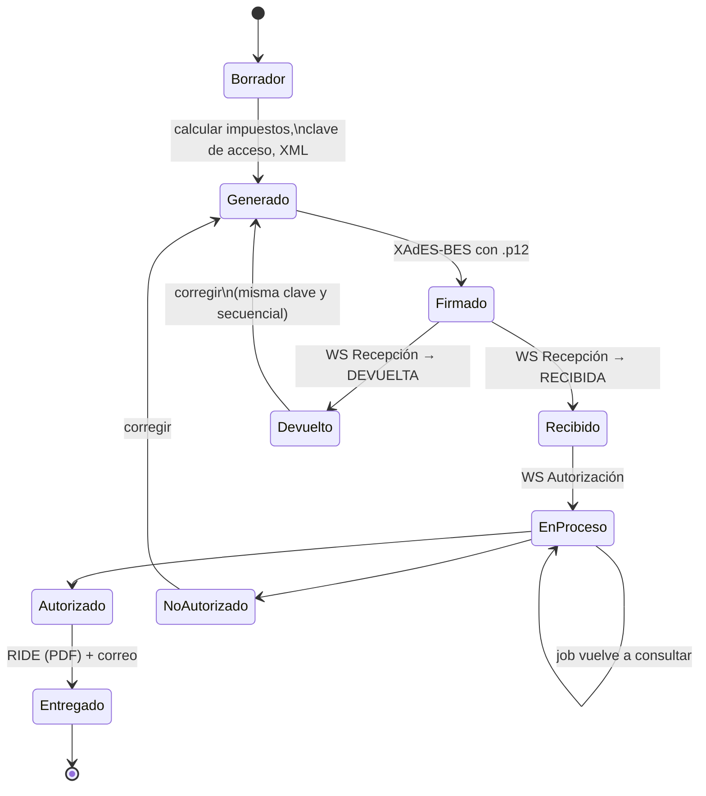

# Plan de despliegue – App de facturación electrónica (SRI)

Relacionado: [[00 - TMR (inicio)]] · [[08 - Despliegue CI-CD]] · [[07 - Notificaciones y cortes]]

> [!summary] Idea central
> Reutilizar la base técnica de TMR (.NET + Angular + PostgreSQL + Docker + GitHub Actions + Dokploy) y su patrón de **eventos con Outbox** para emitir comprobantes electrónicos al SRI de forma asíncrona, con reintentos y sin perder ningún documento.

> [!warning] Verificar contra la fuente oficial
> Los datos técnicos del SRI de esta nota se tomaron de librerías de terceros que citan la **Ficha Técnica de Comprobantes Electrónicos – Esquema Offline v2.34 (julio 2026)**. Antes de implementar, descarga la ficha y los XSD vigentes desde [sri.gob.ec – Facturación electrónica](https://www.sri.gob.ec/facturacion-electronica).

## 1. Qué exige el SRI (resumen)

| Pieza | Detalle |
| --- | --- |
| Comprobantes | Factura (01), Nota de crédito (04), Nota de débito (05), Guía de remisión (06), Comprobante de retención (07) |
| Formato | XML que cumple el XSD oficial de cada tipo y versión |
| Firma | **XAdES-BES enveloped** con certificado PKCS#12 (`.p12`) emitido por una entidad de certificación autorizada en Ecuador |
| Clave de acceso | 49 dígitos: fecha + tipo + RUC + ambiente + serie + secuencial + código numérico + tipo de emisión + dígito verificador (módulo 11) |
| Ambientes | `1` = pruebas, `2` = producción. Cada uno se habilita para el RUC en el portal del SRI |
| Web services (SOAP) | **Recepción** (`validarComprobante`) y **Autorización** (`autorizacionComprobante`) |
| Respuesta | Recepción: `RECIBIDA` o `DEVUELTA`. Autorización: `AUTORIZADO`, `NO AUTORIZADO` o en procesamiento |
| Al cliente | Se le entrega el XML autorizado y el **RIDE** (representación impresa, normalmente PDF) |

| Servicio | Pruebas | Producción |
| --- | --- | --- |
| Recepción | `https://celcer.sri.gob.ec/comprobantes-electronicos-ws/RecepcionComprobantesOffline?wsdl` | `https://cel.sri.gob.ec/comprobantes-electronicos-ws/RecepcionComprobantesOffline?wsdl` |
| Autorización | `https://celcer.sri.gob.ec/comprobantes-electronicos-ws/AutorizacionComprobantesOffline?wsdl` | `https://cel.sri.gob.ec/comprobantes-electronicos-ws/AutorizacionComprobantesOffline?wsdl` |

> [!important] Reglas operativas que afectan el diseño
> - Un comprobante `DEVUELTO` se corrige y se reenvía con **la misma clave de acceso y el mismo secuencial**.
> - Mientras está **en procesamiento**, no se reenvía ni se genera otra clave; solo se vuelve a consultar.
> - Los errores de validación no se reintentan a ciegas: hay que corregir el XML. Solo se reintentan los fallos de red.

## 2. Flujo de emisión

### Cómo encaja con la arquitectura de TMR

| Paso | Pieza nueva | Patrón de TMR que se reutiliza |
| --- | --- | --- |
| Crear factura | `Features/Facturacion/Endpoints` | Minimal APIs + FluentValidation ([[02 - Backend]]) |
| Firmar, enviar, autorizar | Handlers: `FirmarComprobanteHandler`, `EnviarRecepcionHandler`, `ConsultarAutorizacionHandler` | **EventBus + Outbox + EventDispatcher** ([[07 - Notificaciones y cortes]]) |
| Reconsultar pendientes | `RevisarAutorizacionesPendientesJob` | **Quartz** (como `RevisarHorasFaltantesJob`) |
| RIDE | `GenerarRideHandler` | **QuestPDF** |
| Enviar al cliente | `EnviarComprobanteHandler` | **Apprise / MailKit** |
| Estado en pantalla | `ComprobanteEstadoNotifier` | **SSE** |
| Permisos | `FACTURACION_EMITIR`, `FACTURACION_ANULAR`, ... | `PermissionPolicyProvider` ([[05 - Autenticación y permisos]]) |

Eventos sugeridos: `ComprobanteCreado` → `ComprobanteFirmado` → `ComprobanteRecibido` / `ComprobanteDevuelto` → `ComprobanteAutorizado` / `ComprobanteNoAutorizado` → `ComprobanteEntregado`.

## 3. Modelo de datos mínimo

| Tabla | Contenido clave |
| --- | --- |
| `emisor` | RUC, razón social, obligado a llevar contabilidad, régimen, ambiente activo |
| `establecimiento` / `punto_emision` | Códigos `001-001`, dirección |
| `secuencial` | Último número por tipo + establecimiento + punto. **Bloqueo de fila** o restricción única para que dos facturas nunca tengan el mismo número |
| `cliente` | Tipo y número de identificación, correo |
| `producto` | Código, precio, tarifa de IVA |
| `comprobante` | Tipo, clave de acceso (única), estado, totales, fecha emisión, número de autorización, fecha autorización |
| `comprobante_detalle` / `comprobante_impuesto` | Líneas e impuestos |
| `comprobante_archivo` | XML generado, firmado y autorizado; RIDE |
| `comprobante_intento` | Cada llamada al SRI: fecha, servicio, respuesta, mensajes |
| `evento_outbox` | Igual que en TMR |

## 4. Seguridad (lo más crítico)

- [ ] El `.p12` y su contraseña **nunca** en el repo ni en la imagen Docker: secretos del servidor (Dokploy) o un gestor de secretos; idealmente un servicio de firma aislado.
- [ ] Alerta automática **30 días antes** de que venza el certificado de firma.
- [ ] No registrar en logs el XML completo, la clave privada ni la contraseña (Serilog con filtros).
- [ ] TLS con verificación de certificado hacia el SRI; no fijar IPs ni certificados del SRI en el código.
- [ ] Cifrado en reposo de la base y de los respaldos; respaldos diarios con prueba de restauración.
- [ ] Auditoría de quién emitió, anuló o reenvió cada comprobante.
- [ ] Conservar XML autorizados durante el plazo que exige la normativa tributaria (confirmarlo con contabilidad).

## 5. Ambientes

| Ambiente | SRI | Certificado | Datos | Despliegue |
| --- | --- | --- | --- | --- |
| Local | Pruebas (`celcer`) o simulado | De pruebas | Ficticios | `docker compose` |
| DEV | Pruebas (`celcer`) | De pruebas | Ficticios | `a1` automático desde `develop` |
| STAGING | Pruebas (`celcer`) | El real de la empresa, ambiente 1 | Copia anonimizada | Manual, antes de cada release |
| PROD | Producción (`cel`) | El real, ambiente 2 | Reales | `a4` desde `master` con aprobación |

> [!caution] Separar ambientes en la configuración, no en el código
> El ambiente (1/2) y las URLs del SRI deben venir de variables de entorno. Un error aquí emite facturas reales desde DEV.

## 6. Pipeline CI/CD (extendiendo el de TMR)

Se mantienen `a1`–`a4` de [[08 - Despliegue CI-CD]] y se agregan:

1. **Pruebas unitarias** de clave de acceso (dígito verificador), cálculo de impuestos y totales.
2. **Validación XSD** de XML de ejemplo de cada tipo de comprobante.
3. **Pruebas de firma** contra un certificado de pruebas guardado como secreto de CI.
4. **Nunca** llamar al ambiente de producción del SRI desde CI.
5. **Migraciones** de base de datos revisadas en el PR y aplicadas antes de levantar la nueva versión.
6. **Aprobación manual** (environment protegido en GitHub) para el despliegue a PROD.

## 7. Fases

| Fase | Entregable | Criterio para avanzar |
| --- | --- | --- |
| 0. Preparación | Certificado de firma, ambiente de pruebas activo en el portal del SRI, ficha técnica y XSD descargados | Se firma y valida un XML de prueba |
| 1. MVP factura | Emitir factura (01) en ambiente de pruebas con el flujo asíncrono completo | 50 facturas de prueba `AUTORIZADAS`, cero secuenciales repetidos |
| 2. Entrega | RIDE en PDF, envío por correo, consulta y reenvío | El cliente recibe XML + PDF |
| 3. Más comprobantes | Notas de crédito, retenciones, guías según el negocio | Cada tipo validado en pruebas |
| 4. Salida a producción | Ambiente 2 habilitado, monitoreo y runbook | Checklist del punto 9 completo |
| 5. Cobros (opcional) | Registro de pagos, cuentas por cobrar, integración con pasarela | Conciliación pago ↔ factura |

## 8. Monitoreo en producción

| Qué vigilar | Umbral sugerido | Acción |
| --- | --- | --- |
| Comprobantes en procesamiento | Más de 1 hora | Revisar; el SRI puede tardar, no reenviar |
| `DEVUELTA` / `NO AUTORIZADO` | Cualquiera | Alerta al responsable con el mensaje del SRI |
| Eventos en outbox con muchos intentos | Más de 5 | Revisar el handler que falla |
| Vencimiento del certificado | 30 días antes | Renovar |
| Disponibilidad del SRI | Errores de red seguidos | Pausar envíos y reintentar con backoff |
| Health check | Falla | Rollback a la imagen anterior en Dokploy |

## 9. Checklist de salida a producción

- [ ] Ambiente de producción habilitado para el RUC en el portal del SRI
- [ ] Certificado real cargado como secreto y probado
- [ ] Variables de PROD revisadas: ambiente `2`, URLs `cel.sri.gob.ec`
- [ ] Secuenciales iniciales acordados con contabilidad
- [ ] Respaldos automáticos y una restauración probada
- [ ] Alertas configuradas (punto 8)
- [ ] Runbook: qué hacer si el SRI no responde o si se emite un comprobante erróneo (nota de crédito)
- [ ] Plan de rollback: imagen anterior en GHCR + migración reversible

## 10. Riesgos

| Riesgo | Mitigación |
| --- | --- |
| Firma XAdES mal implementada (canonicalización, namespaces) | Usar una librería probada y validar en pruebas antes de escribir lógica propia |
| Secuencial duplicado con usuarios simultáneos | Bloqueo de fila o restricción única + transacción |
| Cambio de ficha técnica o XSD del SRI | XSD versionados en el repo; revisar novedades del SRI cada trimestre |
| Filtración del `.p12` | Secretos fuera del código, acceso mínimo, rotación |
| Caída del SRI | Outbox + reintentos con backoff; los comprobantes no se pierden |

## Fuentes

- [SRI – Facturación electrónica](https://www.sri.gob.ec/facturacion-electronica) (fuente oficial: ficha técnica y XSD)
- [sri-comprobantes-php](https://packagist.org/packages/julioserpone/sri-comprobantes-php) – endpoints verificados el 20/10/2026, estructura de la clave de acceso, estados y reglas de reenvío
- [open-factura](https://www.npmjs.com/package/open-factura) – ejemplo de flujo generar → firmar → recepción → autorización
