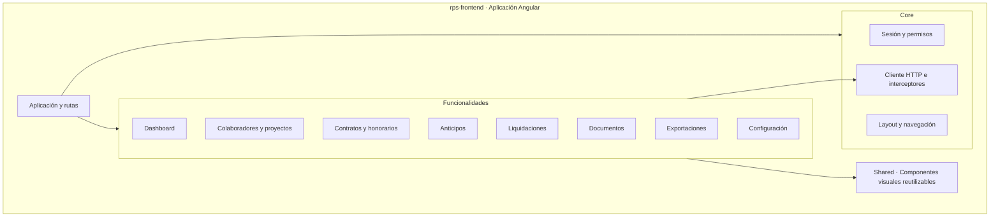

pantallas principales : 
Inicio
Colaboradores 
contratos
anticipos
liquidaciones
documentos
exportaciones
configuracion

Inicio tiene:
una parte donde muestra la fecha por ejemplo solo muestra "Noviembre 2026"

Resumen neto

el uno y quincena

fin de mes

16 al 30 de noviembre 

Por revisar 
aqui estan los colaboradores pendientes

![[Pasted image 20261027095403.png]]

Frontend:

