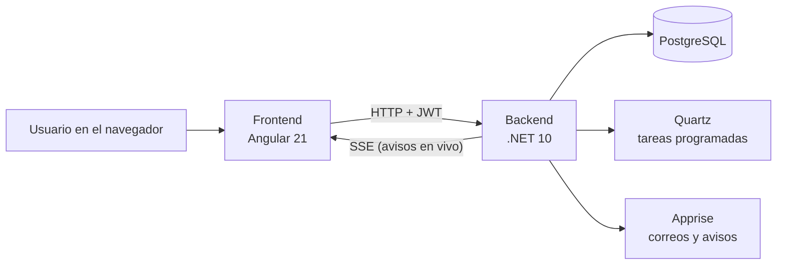

# TMR – Time Report

> [!summary] En una frase
> TMR es un sistema web donde los colaboradores registran las horas que trabajan en cada proyecto, los líderes las revisan y, en cada **fecha de corte**, el sistema avisa a quien le faltan horas.

## Las piezas

| Pieza | Carpeta | Qué hace |
| --- | --- | --- |
| Frontend | `tmr-frontend` | Las pantallas. Muestra datos y envía pedidos |
| Backend | `tmr-backend` | Las reglas, la seguridad y el acceso a la base de datos |
| Base de datos | PostgreSQL | Donde todo queda guardado |
| Docker / CI | `docker/`, `.github/` | Cómo se empaqueta y se publica |

## Ruta de lectura

1. [[01 - Arquitectura general]] – cómo se conectan las piezas
2. [[02 - Backend]] – cómo está organizado el código .NET
3. [[03 - Frontend]] – cómo está organizado el código Angular
4. [[04 - Base de datos]] – qué se guarda y dónde
5. [[05 - Autenticación y permisos]] – login, JWT, roles
6. [[06 - Flujo registro de horas]] – el caso de uso principal, paso a paso
7. [[07 - Notificaciones y cortes]] – el módulo más elaborado
8. [[08 - Despliegue CI-CD]] – de un commit a producción
9. [[09 - Glosario]] – palabras técnicas explicadas

Relacionado: [[Plan de despliegue - Facturación SRI]]

## Módulos funcionales

| Módulo | Para qué sirve |
| --- | --- |
| Time Report | Registrar actividades diarias y hacer seguimiento de horas |
| Fechas de corte | Definir cuándo se cierran los períodos de horas |
| Notificaciones | Avisar horas faltantes por correo y en la app |
| Dashboard | Métricas ejecutivas: horas, proyectos próximos a cerrar |
| Proyectos / Clientes | Quién paga y en qué se trabaja |
| Colaboradores / Líderes | Personas, contratos y quién supervisa a quién |
| Proveedores / Inventario | Equipos, facturas de compra, asignaciones |
| Configuración | Usuarios, roles, permisos, feriados, catálogos |
| Carga de actividades | Importar horas desde Excel |
| Reportes | Exportar a PDF y Excel |

> [!tip] Cómo se hicieron estas notas
> El código se analizó con **Graphify** (`graphify-out/` en cada repo): ~5.900 nodos y ~12.400 conexiones entre ambos proyectos. Las piezas más conectadas son `ApplicationDbContext` en el backend y `ProyectoFormComponent` / `SeguimientoComponent` en el frontend.
