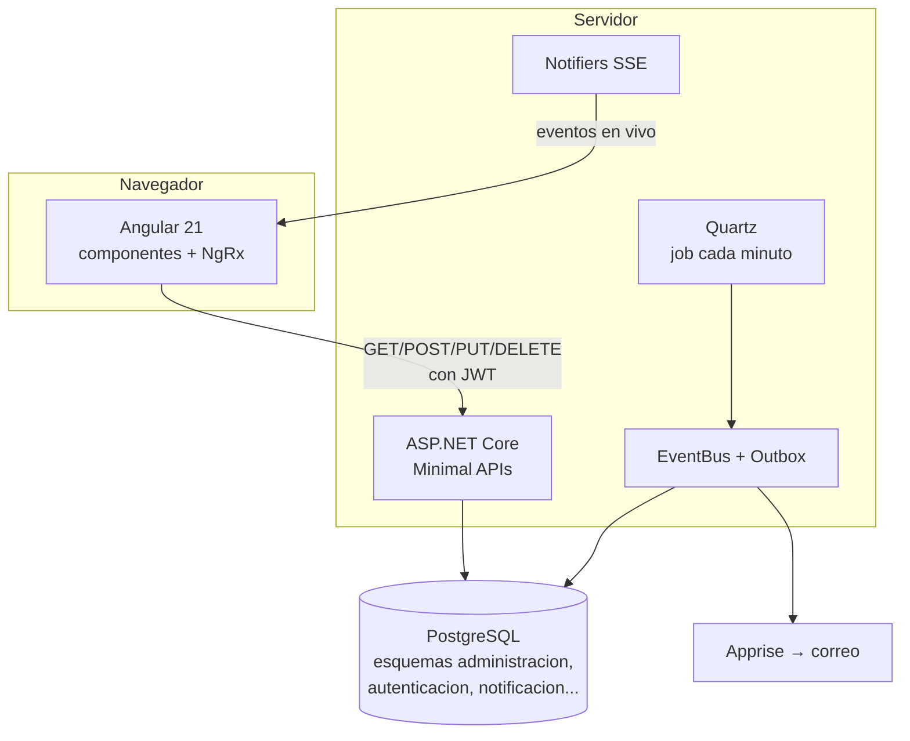

# Arquitectura general

← [[00 - TMR (inicio)]]

TMR sigue la arquitectura clásica **cliente–servidor** en tres capas: el navegador muestra, el servidor decide y la base de datos recuerda.

## Analogía: un restaurante

| En el restaurante                               | En TMR                            |
| ----------------------------------------------- | --------------------------------- |
| El mesero que toma tu pedido                    | El **frontend** (Angular)         |
| La cocina que prepara y revisa el pedido        | El **backend** (.NET)             |
| La despensa y el cuaderno de pedidos            | La **base de datos** (PostgreSQL) |
| La pulsera que demuestra que pagaste la entrada | El **JWT**                        |
| El reloj que avisa la hora de cierre            | **Quartz** (tareas programadas)   |
| El altavoz que anuncia "pedido listo"           | **SSE** (notificaciones en vivo)  |

## Decisiones de diseño importantes

- **Dos repositorios separados.** `tmr-frontend` y `tmr-backend` tienen su propio git, su propio pipeline y su propia imagen Docker. Se pueden desplegar por separado.
- **Organización por features (vertical slices).** En vez de carpetas por tipo (todos los controladores juntos, todos los servicios juntos), cada módulo tiene su propia carpeta con todo lo suyo. Ver [[02 - Backend]] y [[03 - Frontend]].
- **Las reglas viven en el backend.** El frontend valida para dar buena experiencia, pero el backend vuelve a validar todo, porque lo que pasa en el navegador se puede manipular. Ver [[06 - Flujo registro de horas]].
- **Eventos con Outbox.** Las notificaciones no se envían "en caliente": primero se guarda el evento en la base de datos y luego se procesa. Si el servidor se cae, no se pierde nada. Ver [[07 - Notificaciones y cortes]].

## Cómo se comunican frontend y backend

1. El frontend llama a URLs como `/api/time-report/actividades`, definidas en `environment.apiUrl`.
2. Cada pedido lleva el JWT en la cabecera `Authorization` (lo agrega `TokenInterceptor`).
3. El backend responde JSON. `ApiResponseInterceptor` en el frontend procesa esas respuestas de forma uniforme.
4. Para avisos en tiempo real, el frontend abre conexiones SSE (`/estado/stream`, `/cortes/stream`, `/mias/stream`) que el backend mantiene abiertas.

> [!warning] Lo que el grafo no ve
> Graphify analiza el código por separado en cada repo, así que no dibuja la línea "esta pantalla llama a este endpoint". Esa relación hay que seguirla a mano: servicio Angular → URL → `Map...` en el backend.
