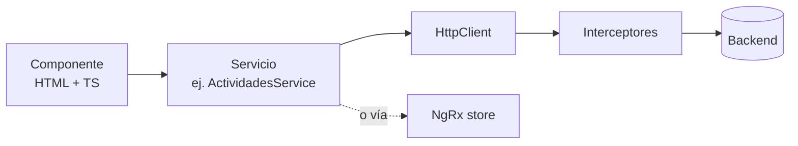

# Frontend (`tmr-frontend`)

← [[00 - TMR (inicio)]] · [[01 - Arquitectura general]]

Aplicación **Angular 21** con TypeScript. Unos 333 archivos y ~2.900 nodos en el grafo. Se compila a archivos estáticos que sirve **nginx** dentro de un contenedor.

## Estructura de carpetas

```
src/app/
├── app.config.ts        ← providers globales: HttpClient, interceptores, NgRx
├── app.routes.ts        ← mapa de URLs → pantallas
├── core/                ← lo que usa toda la app, una sola vez
│   ├── guards/          ← auth.guard, role.guard
│   ├── interceptors/    ← token, api-response, cambios-datos
│   ├── layout/          ← navbar, sidebar, layout principal
│   ├── initializers/    ← carga los módulos permitidos al usuario
│   ├── components/      ← modal de expiración de sesión
│   └── state/ services/ config/ models/
├── features/            ← un módulo por carpeta
│   ├── auth/  dashboard/  time-report/  proyectos/
│   ├── colaboradores/  clientes/  proveedores/  lideres/
│   ├── configuracion/  carga-actividades/  reportes/
└── shared/              ← componentes y servicios reutilizables
    ├── components/      ← tabla, paginación, action-menu, header...
    └── services/        ← actividades.service, fecha-limites.service...
```

## Rutas principales

| URL | Pantalla |
| --- | --- |
| `/auth` | Login, olvidé mi contraseña, reset |
| `/dashboard` | Dashboard ejecutivo |
| `/time-report/horas` | Registro de actividades (calendario) |
| `/time-report/fechas` | Fechas de corte |
| `/proyectos`, `/clientes`, `/colaboradores`, `/lideres`, `/proveedores` | Mantenimientos |
| `/configuracion/usuarios`, `/roles`, `/feriados`, `/catalogos` | Configuración |
| `/carga-actividades`, `/reportes` | Importación y exportación |

Las rutas protegidas pasan por `auth.guard` (¿hay sesión?) y `role.guard` (¿tiene permiso para este módulo?).

## Tecnologías y para qué se usan

| Tecnología | Uso en TMR |
| --- | --- |
| Angular 21 + TypeScript | Componentes de pantalla |
| NgRx (store + effects) | Estado compartido: sesión, clientes, etc. |
| RxJS | Manejar datos que llegan "más tarde" (HTTP, SSE) |
| HttpClient + interceptores | Comunicación con el backend |
| Angular Material + CDK | Tablas, modales, selectores |
| Tailwind CSS | Estilos con clases utilitarias |
| jsPDF / ExcelJS / JSZip | Exportar PDF y Excel desde el navegador |
| SweetAlert2 | Alertas y confirmaciones |
| driver.js / Shepherd.js | Tours guiados |

## Los tres interceptores

Un interceptor es código que se ejecuta en **todos** los pedidos HTTP, como un filtro.

| Interceptor | Qué hace |
| --- | --- |
| `TokenInterceptor` | Agrega el JWT a cada pedido y gestiona su renovación |
| `ApiResponseInterceptor` | Procesa las respuestas del backend de forma uniforme |
| `CambiosDatosInterceptor` | Detecta cambios de datos para refrescar lo que haga falta |

## Componentes más importantes (según el grafo)

| Componente | Conexiones | Dónde |
| --- | --- | --- |
| `ProyectoFormComponent` | 90 | `features/proyectos/componentes/proyecto-form` |
| `SeguimientoComponent` | 72 | `features/time-report/seguimiento` |
| `LideresComponent` | 60 | `features/lideres/components` |
| `DashboardEjecutivoComponent` | 54 | `features/dashboard/componentes` |
| `TokenService` | 46 | sesión y renovación del token |

## Patrón de una pantalla típica



1. El **componente** muestra la pantalla y reacciona a clics.
2. Llama a un **servicio**, que sabe a qué URL ir.
3. El servicio usa **HttpClient**; los **interceptores** agregan el token.
4. La respuesta vuelve al componente (o al store de NgRx) y la pantalla se actualiza.

## Renovación de sesión según actividad

`UserActivityService` vigila movimiento del mouse, clics, teclas y scroll. Si el token está por vencer **y** el usuario está activo, se renueva en silencio. Si está inactivo, aparece el modal de expiración. Documentado en `documentacion/IMPLEMENTACION_TOKEN_REFRESH_CON_ACTIVIDAD.md`. Ver [[05 - Autenticación y permisos]].

> [!bug] Deuda técnica detectada
> `action-menu` y `descarga-menu` existen duplicados en `shared/components` y en `shared/components/menus`. Algunos modales (descarga en Líderes, confirmación) son casi iguales a componentes compartidos.
