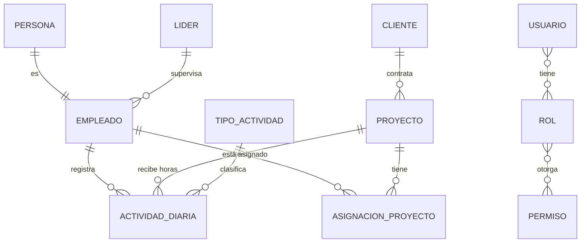

# Base de datos

← [[00 - TMR (inicio)]] · [[02 - Backend]]

TMR usa **PostgreSQL**, y el backend accede a ella con **Entity Framework Core** a través de `ApplicationDbContext`. Las tablas se agrupan en **esquemas** (carpetas dentro de la base de datos) según su área.

## Esquemas y tablas principales

| Área (prefijo)                        | Para qué                                 | Tablas destacadas                                                                                                                                               |
| ------------------------------------- | ---------------------------------------- | --------------------------------------------------------------------------------------------------------------------------------------------------------------- |
| Administración (`TblAdministracion*`) | Personas, empleados, clientes, catálogos | `Persona`, `Empleado`, `EmpleadoContrato`, `Lider`, `Cliente`, `Catalogo`, `CatalogoDetalle`, `Cargo`                                                           |
| Autenticación (`TblAutenticacion*`)   | Usuarios y seguridad                     | `Usuario`, `Rol`, `Permiso`, `RolPermiso`, `UsuarioRol`, `RefreshToken`, `Sesion`, `TokenBlacklist`, `PasswordReset`, `PasswordHistorial`, `AuditLog`, `Modulo` |
| Time Report (`TblTimeReport*`)        | Lo central: horas y proyectos            | `ActividadDiaria`, `Proyecto`, `AsignacionProyecto`, `TipoActividad`, `TipoProyecto`, `Feriado`, `ProyeccionHoras`                                              |
| Inventario (`TblInventario*`)         | Equipos y compras                        | `Equipo`, `Factura`, `DetalleFactura`, `Proveedor`, `AsignacionEquipo`, `ReparacionEquipo`, `BajaEquipo`                                                        |
| Auditoría (`TblAuditoria*`)           | Historial de cambios                     | `Empleado`, `Equipo`, `SesionUsuario`, `HistoricoGeneral`                                                                                                       |
| Notificación                          | Avisos y eventos                         | `notificacion_fecha_corte`, `notificacion_envio`, `evento_outbox`                                                                                               |

Confirmados en el código como esquemas de PostgreSQL: `administracion`, `auditoria` y `notificacion`. Las demás áreas siguen el mismo patrón de nombres.

> [!info] Nombres de tablas
> En C# las entidades se llaman en PascalCase (`TblAdministracionEmpleado`) y en la base de datos en snake_case dentro de su esquema (`administracion.tbl_administracion_empleado`). EF Core hace la traducción.

## Cómo se relacionan las piezas clave

> [!warning] Diagrama aproximado
> Las relaciones salen de cómo el código usa las entidades. Para el detalle exacto (claves foráneas, nulabilidad) revisa `Infrastructure/Database/Entities/` y `ApplicationDbContext.OnModelCreating()`.

## Entidades más conectadas (según el grafo)

| Entidad | Conexiones | Por qué importa |
| --- | --- | --- |
| `TblAdministracionEmpleado` | 76 | Casi todo gira alrededor del colaborador |
| `TblAdministracionCatalogoDetalle` | 59 | Valores configurables (estados, tipos) |
| `TblAutenticacionUsuario` | 50 | Login y permisos |
| `TblTimeReportProyecto` | 50 | Donde se cargan las horas |
| `TblAdministracionPersona` | 43 | Datos personales |
| `TblInventarioEquipo` | 42 | Inventario |

## Migraciones e instalador

- `Migrations/` guarda la historia de cambios de estructura (la primera es `InitialCreate`).
- `Documentacion/Scripts_DB/00-ORDEN_DESPLIEGUE.md` describe un instalador controlado con comandos `--prepare-database` → `--initialize-data` → verificación → health check, para levantar una base nueva de forma reproducible.

## Patrón común en las tablas

Muchas tablas tienen columnas de auditoría: `Activo`, `Fechacreacion`, `Usuariocreacion`, `Ipcreacion`. En vez de borrar filas, se suele marcar `Activo = false` (borrado lógico).
