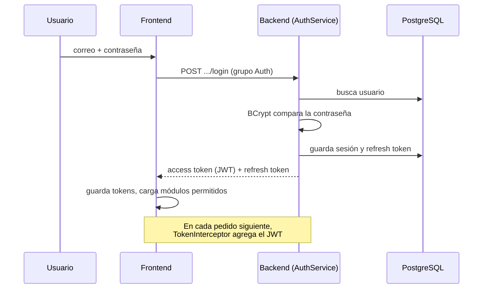
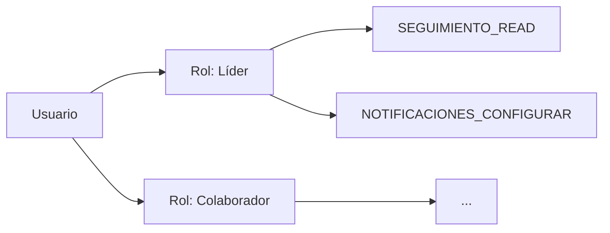

# Autenticación y permisos

← [[00 - TMR (inicio)]] · [[02 - Backend]] · [[03 - Frontend]]

Dos preguntas distintas que TMR responde en cada pedido:

- **Autenticación:** ¿quién eres? → usuario + contraseña → JWT.
- **Autorización:** ¿qué puedes hacer? → roles → permisos.

## Login paso a paso



## Los dos tokens

| Token | Duración (`appsettings.json`) | Para qué |
| --- | --- | --- |
| Access token (JWT) | 60 minutos | Se envía en cada pedido; prueba quién eres |
| Refresh token | 7 días | Pedir un access token nuevo sin volver a escribir la contraseña |
| Inactividad máxima | 2 días (`IdleTimeoutDays`) | Cierra sesiones abandonadas |

> [!example] Analogía
> El **access token** es la pulsera de un evento: válida por poco tiempo y la muestras en cada puerta. El **refresh token** es tu entrada original: la usas para pedir una pulsera nueva cuando la tuya vence.

## Endpoints de `Features/Auth`

| Endpoint | Qué hace |
| --- | --- |
| `POST /login` | Inicia sesión |
| `POST /refresh-token` | Renueva el access token |
| `POST /logout`, `/logout-rt` | Cierra sesión |
| `POST /revoke-token` | Invalida un token (va a la blacklist) |
| `POST /forgot-password`, `/reset-password` | Recuperar contraseña por correo |
| `POST /change-password` | Cambiar contraseña |
| `POST /register` | Registrar usuario |
| `GET /modules` | Módulos del menú que el usuario puede ver |

## Cómo funcionan los permisos



1. Un **usuario** tiene uno o varios **roles** (`TblAutenticacionUsuarioRol`).
2. Cada rol tiene **permisos** (`TblAutenticacionRolPermiso`).
3. `PermissionService` lee esos permisos y los pone en el JWT como *claims* `permission`.
4. `PermissionPolicyProvider` crea una política por permiso al vuelo. Así un endpoint puede exigir uno concreto:

```csharp
app.MapGroup("/api/time-report/seguimiento")
   .RequireAuthorization("SEGUIMIENTO_READ");
```

5. En el frontend, `role.guard` y `load-user-modules.initializer` ocultan las pantallas que el usuario no puede usar. Esto es solo comodidad: la protección real es la del backend.

## Otras medidas de seguridad

- Contraseñas con **BCrypt** e historial para no repetirlas (`PasswordHistorial`).
- **Rate limiting** en la política `auth` para frenar ataques de fuerza bruta en el login.
- **Blacklist** de tokens revocados y registro de sesiones (`TblAutenticacionSesion`).
- `SessionCleanupService` limpia sesiones viejas en segundo plano.
- `AuditLog` registra acciones sensibles.

## Renovación silenciosa en el frontend

`TokenService` + `UserActivityService` (en `core/`): si el JWT está por vencer y el usuario se movió en los últimos segundos, se pide uno nuevo en silencio. Si no hay actividad, aparece `session-expiration-modal` para que el usuario decida.
