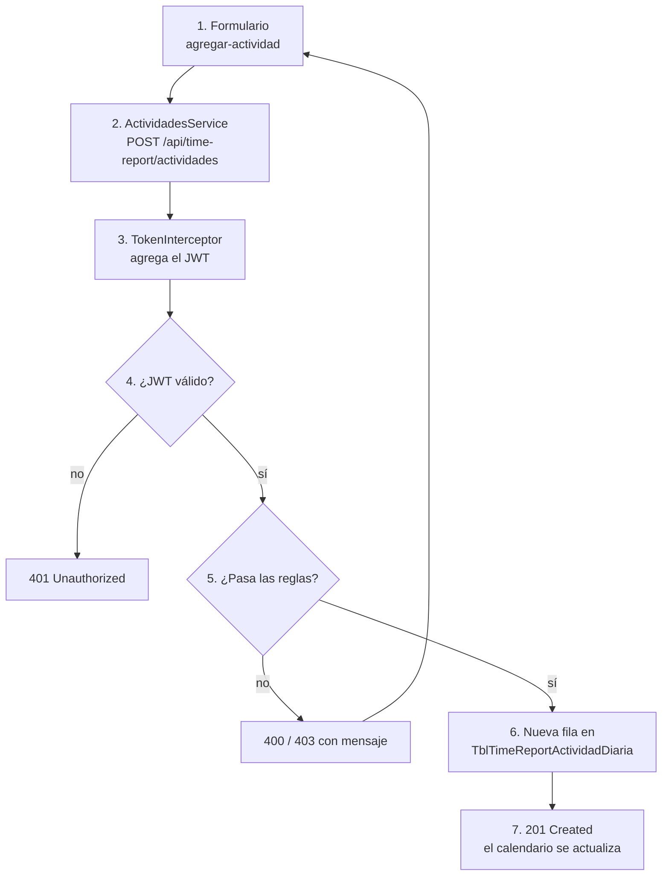

# Flujo: registrar horas

← [[00 - TMR (inicio)]] · [[03 - Frontend]] · [[02 - Backend]] · [[04 - Base de datos]]

El caso de uso principal de TMR: un colaborador anota cuántas horas trabajó, en qué proyecto y en qué día. Recorrerlo de punta a punta explica cómo funciona todo el sistema.

## Paso a paso

**1. El formulario (frontend).**
En `features/time-report/actividades/agregar-actividad`, el colaborador elige fecha, horas, proyecto, tipo de actividad y escribe una descripción.

**2. El servicio arma el pedido.**
`shared/services/actividades.service.ts` tiene la URL base `${environment.apiUrl}/time-report/actividades` y hace `this.http.post(this.apiUrl, payload)`. Un **POST** significa "crear algo nuevo".

**3. El interceptor agrega la credencial.**
Antes de salir, `TokenInterceptor` pone el JWT en la cabecera. Ver [[05 - Autenticación y permisos]].

**4. El backend revisa el JWT.**
El grupo `/api/time-report/actividades` tiene `.RequireAuthorization()`. Sin token válido, la respuesta es `401` y el código del endpoint ni se ejecuta.

**5. El backend aplica las reglas del negocio** (`TimeReportEndpoints.cs`, `MapPost("/")`):

| Regla | Si falla |
| --- | --- |
| Solo puedes registrar horas **tuyas** (el empleado del token debe ser el del pedido) | `403 Forbidden` |
| Máximo **24 horas** sumadas en un mismo día | `400`: "No puede registrar más de 24 horas en un mismo día." |
| No después de tu **fecha de salida**, si tienes una | `400` con mensaje |
| Debes estar **asignado al proyecto** en esa fecha (primero se asigna, luego se carga) | `400` con mensaje |

**6. Se guarda.**
Se crea un objeto `TblTimeReportActividadDiarium` con los datos más `Activo = true`, `Fechacreacion`, etc., se agrega con `db.TblTimeReportActividadDiaria.Add(...)` y `await db.SaveChangesAsync()` lo escribe en PostgreSQL.

**7. La respuesta.**
`Results.Created(...)` devuelve `201` con la actividad creada. El frontend refresca el calendario (`GET .../calendario?idEmpleado=...&anio=...&mes=...`).

## Otros endpoints del mismo módulo

| Endpoint | Para qué |
| --- | --- |
| `GET /actividades/calendario` | Actividades de un mes para pintar el calendario |
| `GET /actividades/resumen` | Totales de horas (hoy, semana, mes) |
| `GET /actividades/proyectos-disponibles` | Proyectos donde el usuario puede cargar |
| `GET /actividades/tipos-actividad` | Catálogo de tipos |
| `GET /actividades/fecha-minima` | Hasta qué fecha atrás se puede registrar |
| `PUT /actividades/{id}` / `DELETE /actividades/{id}` | Editar o eliminar |
| `GET /seguimiento` | Vista del líder (exige `SEGUIMIENTO_READ`) |

> [!important] Por qué las reglas están en el backend
> El frontend también puede validar para avisar antes, pero cualquiera puede abrir las herramientas del navegador y enviar un pedido manipulado. Lo único confiable es lo que se revisa en el servidor.

> [!todo] Detalle mejorable en el código
> Al crear la actividad se guarda `Usuariocreacion = "Sistema"` e `Ipcreacion = "127.0.0.1"` fijos; el propio comentario del código dice que debería tomarse del token.
