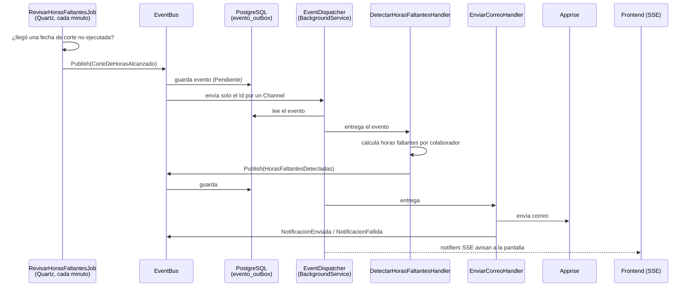

# Notificaciones y fechas de corte

← [[00 - TMR (inicio)]] · [[02 - Backend]]

Es el módulo más elaborado del backend: combina tareas programadas, eventos con Outbox, envío por correo y avisos en vivo. Su objetivo: **en cada fecha de corte, detectar quién no completó sus horas y avisarle.**

## Conceptos

| Concepto | Qué es |
| --- | --- |
| **Fecha de corte** | Momento en que se cierra un período de horas. Por defecto: día 15 y último día del mes, 18:00 hora de Ecuador. Se crean solas y se cambian en la pantalla *Fechas de Corte* (permiso `NOTIFICACIONES_CONFIGURAR`) |
| **Horas faltantes** | Diferencia entre las horas esperadas del período y las registradas (`CalculadorHorasFaltantes`) |
| **Evento** | Un hecho que ya ocurrió, con nombre en pasado: `CorteDeHorasAlcanzado`, `HorasFaltantesDetectadas`, `NotificacionEnviada`, `NotificacionFallida`, `NotificacionOmitida`, `NotificacionManualSolicitada` |
| **Handler** | Código que reacciona a un evento: `DetectarHorasFaltantesHandler`, `EnviarCorreoHandler`, `RegistrarEnvioHandler`, `FalloDefinitivoHandler` |
| **Outbox** | Tabla `notificacion.evento_outbox` donde se guarda cada evento antes de procesarlo |

## El flujo completo



## Por qué un Outbox

`EventBus.PublishAsync` hace dos cosas en orden:

1. **Guarda el evento en PostgreSQL** con estado `Pendiente`. A partir de aquí ya no se pierde.
2. **Avisa al dispatcher** escribiendo solo el `Id` en un `Channel` en memoria.

`EventDispatcher` es un servicio que vive mientras el backend está encendido:

- Al arrancar, **recupera los eventos pendientes** que quedaron si el servidor se cayó.
- Luego espera Ids del canal sin consumir CPU.
- Por cada evento crea un *scope* nuevo (su propio `DbContext`), reconstruye el evento desde su JSON, busca los handlers registrados y se lo entrega a cada uno.
- Si un handler falla, registra el error, cuenta el intento y sigue con el siguiente evento.

> [!example] Analogía
> Es como un restaurante que **anota cada pedido en un cuaderno** antes de pasarlo a la cocina. Si se va la luz, al volver revisan el cuaderno y siguen con lo que quedó pendiente. Sin cuaderno, los pedidos "en el aire" se perderían.

## Avisos en tiempo real (SSE)

Tres *notifiers* empujan información al navegador sin que este pregunte:

| Notifier | Stream | Qué avisa |
| --- | --- | --- |
| `NotificacionEstadoNotifier` | `/estado/stream` | Progreso de un envío |
| `CorteNotifier` | `/cortes/stream` | Que se alcanzó un corte |
| `AvisoColaboradorNotifier` | `/mias/stream` | Avisos personales del colaborador |

En el frontend, la comunidad *Notificaciones y Resumen de Corte* del grafo agrupa las pantallas que consumen esto.

## Endpoints del módulo

| Endpoint | Para qué |
| --- | --- |
| `GET /pendientes` | Colaboradores con horas faltantes |
| `POST /notificar` | Envío **manual** de avisos |
| `GET /estado`, `/cortes/ultimo` | Estado actual y último corte |
| `GET`, `PUT /{id}`, `POST /{id}/restablecer` (Fechas de corte) | Ver, cambiar o restablecer las fechas |

## Configuración

En `appsettings.json`:

```json
"NotificacionHoras": {
  "Habilitado": false,
  "UmbralNotificacionManual": 24
}
```

> [!warning] Viene apagado
> `Habilitado: false` hace que el job salga sin hacer nada. Hay que activarlo por ambiente (variable de entorno o appsettings del servidor). Apprise se configura con `ApiUrl` y `UrlTemplates`.

Además existe `WeeklyNotificationService` en `Infrastructure/BackgroundServices` para avisos semanales.

Documentos relacionados en la carpeta `TMR`: `Propuesta_Arquitectura_Notificacion.pdf` y `Reparto_Trabajo_Notificaciones.docx`.
