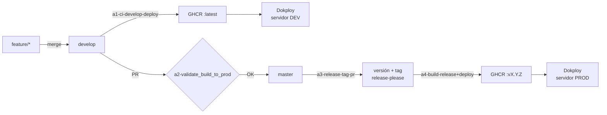

# Despliegue y CI/CD

← [[00 - TMR (inicio)]] · relacionado: [[Plan de despliegue - Facturación SRI]]

Los dos repos se empaquetan en **contenedores Docker** y se publican con **GitHub Actions** → **GHCR** → **Dokploy**. Ambos tienen los mismos cuatro workflows.

## Contenedores

| Repo | Archivo | Etapa de build | Imagen final |
| --- | --- | --- | --- |
| Backend | `.docker/containerfile` | `mcr.microsoft.com/dotnet/sdk:10.0-alpine` | `mcr.microsoft.com/dotnet/aspnet:10.0-alpine` |
| Frontend | `.docker/containerfile` + `nginx.conf` | `node:20-alpine` (compila Angular) | `nginx:alpine` (sirve archivos estáticos) |

Es un **build multi-etapa**: se compila con una imagen grande que tiene el SDK y se copia solo el resultado a una imagen pequeña. La imagen final pesa menos y tiene menos superficie de ataque.

Para desarrollo local: `docker/docker-compose.local.yml` levanta los servicios `backend` y `frontend` con las variables de `docker/env`.

## Ramas y workflows



| Workflow | Disparador | Qué hace |
| --- | --- | --- |
| `a1-ci-develop-deploy` | push a `develop` | Compila, crea imagen, la sube a GHCR y despliega en DEV |
| `a2-validate_build_to_prod` | PR `develop` → `master` | Verifica que compile antes de permitir el merge |
| `a3-release-tag-pr` | push a `master` | release-please calcula la versión, actualiza `CHANGELOG.md` y crea el tag |
| `a4-build-release+deploy` | release creado | Construye la imagen versionada y despliega en PROD |

## Configuración por ambiente

- Backend: `appsettings.json` + `appsettings.Development.json` + variables de entorno (`.env.example` como plantilla). `Jwt:SecretKey` viene vacío en el repo y se inyecta en el servidor.
- Frontend: `environments/` define `apiUrl`; `proxy.conf.json` redirige las llamadas al backend durante el desarrollo local.

## Instalación controlada de la base de datos

`Documentacion/Scripts_DB/00-ORDEN_DESPLIEGUE.md`: el backend acepta comandos de instalación en orden:

1. `--prepare-database` – aplica el SQL versionado embebido.
2. `--initialize-data` – crea el admin inicial y permisos base.
3. Verificación.
4. Health check (`Features/HealthCheck`).

## Comandos útiles

```bash
# Backend local
dotnet run

# Frontend local
npm install
npm start          # ng serve con proxy a la API

# Todo con Docker
docker compose -f docker/docker-compose.local.yml up --build
```
